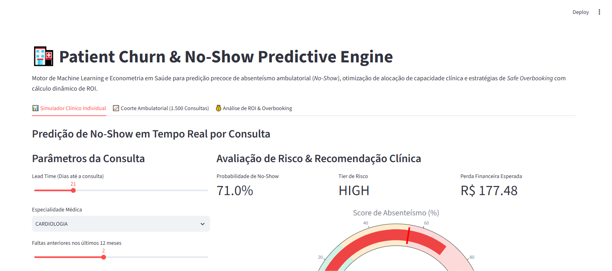

# 🏥 Patient Churn & No-Show Predictive Engine

[](crisp_dm/01_business_understanding.md)
[](SPEC.md)
[](docs/screenshots/no_show_analyzer.png)
[](https://www.python.org/)

Motor analítico preditivo orientado por Machine Learning e Econometria em Saúde para predição precoce de absenteísmo ambulatorial (*No-Show*), mitigação de evasão de pacientes crônicos (*Patient Churn*) e política de sobre-agendamento seguro (*Safe Overbooking*) com maximização de ROI hospitalar.

---

## 📸 Validação Visual do Sistema (Playwright E2E)

A interface interativa do motor foi testada e capturada via **Playwright E2E**:



---

## 🎯 Problema de Negócio & Impacto Hospitalar

1. **Impacto Clínico:** A falta do paciente compromete a adesão a tratamentos contínuos, agravando descompensações agudas em doenças crônicas e sobrecarregando o pronto-socorro.
2. **Impacto Econômico:** Cada hora ambulatorial ociosa gera desperdício de R$ 150 a R$ 350 por consultório médico, acumulando milhões em receita perdida anualmente em redes hospitalares.
3. **Solução Desenvolvida:**
   - **Score de Risco Multivariado:** Combinação de histórico do paciente, lead time, especialidade e distância geográfica.
   - **Camada de Decisão Automatizada:**
     - `LOW`: Confirmação automatizada padrão (baixo custo).
     - `MEDIUM`: Contato ativo multicanal (ligação humanizada e WhatsApp).
     - `HIGH`: Slot de sobre-agendamento controlado (*Safe Overbooking*) com política de contingência.

---

## 📐 Metodologia CRISP-DM & Arquitetura

O ciclo de vida do projeto segue rigorosamente o padrão **CRISP-DM**:
- **01. Business Understanding:** Redução de perdas por no-show de R$ 250/consulta com intervenção de custo unitário de R$ 4,50 a R$ 15,00.
- **02. Data Understanding:** Análise de correlações entre dias de antecedência (lead time), distância e absenteísmo.
- **03. Data Preparation:** Normalização de variáveis e contratos estritos validados com Pydantic v2.
- **04. Modeling:** Modelo logístico comportamental calibrado por especialidade clínica.
- **05. Evaluation:** Validação de sensibilidade e impacto líquido de ROI.
- **06. Deployment:** Container Dockerizado e aplicação Streamlit analítica.

---

## 🚀 Execução Local & Testes

### Pré-requisitos
```bash
python -m venv venv
venv\Scripts\activate
pip install -r requirements.txt
```

### Executar Testes Unitários
```bash
python -m pytest tests/unit/ -v
```

### Iniciar Aplicação
```bash
python -m streamlit run src/app.py
```

### Executar com Docker
```bash
docker build -t no-show-analyzer .
docker run -p 8501:8501 no-show-analyzer
```

---

## 📄 Licença
Distribuído sob licença MIT. Desenvolvido para portfólio de excelência em Ciência de Dados e IA para a Saúde.
